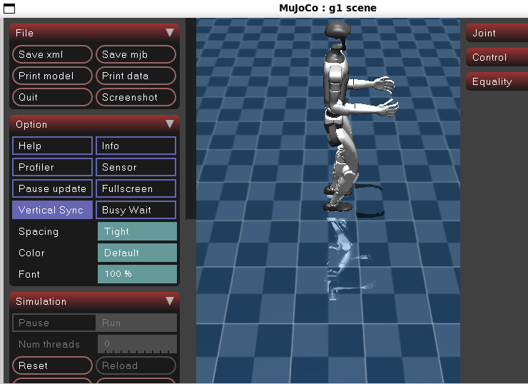
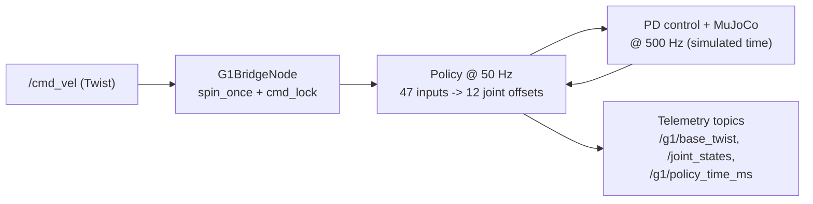

# g1-ros2-bridge


ROS 2 interface and live monitoring for a **pre-trained reinforcement-learning walking policy** of the
**Unitree G1** humanoid, running in the **MuJoCo** simulator.

This repository extends the MuJoCo deployment script of
[`unitree_rl_gym`](https://github.com/unitreerobotics/unitree_rl_gym) with:

- a `/cmd_vel` subscriber, so that any ROS 2 node (teleoperation, navigation stack) can command the walking speed;
- telemetry publishers: measured base velocity, joint states and policy inference time;
- a script that analyzes recorded runs (rosbag2): velocity tracking and inference-time statistics.

Developed during an internship at CDTA (Division Productique et Robotique, DPR), September 2026.
Full report: [`report/report.pdf`](report/report.pdf)



> **What this is not.** No policy training is done here. The walking policy (`motion.pt`) and the robot
> model come from Unitree. Everything runs in simulation; nothing was tested on the physical robot.

---

## How it works (one minute)



- The **policy** is the slow "brain": 50 times per simulated second it decides where each of the 12 leg joints should go.
- The **PD controller** is the fast "reflex": 500 times per second it turns the remaining position error into torque.
- The ROS 2 node runs in the **same single thread** as the simulation: at every physics step it processes pending
  `/cmd_vel` messages with `rclpy.spin_once(timeout_sec=0.0)`.

More detail: [`docs/architecture.md`](docs/architecture.md).

## Requirements


| Component | Version |
|---|---|
| OS | Ubuntu 22.04 on WSL2 |
| ROS 2 | Humble |
| Python | 3.10 |
| MuJoCo (Python) | 3.14.0 |
| PyTorch | 2.14.0+cpu |
| `unitree_rl_gym` | commit 276801e |

## Installation

```bash
# 1. ROS 2 Humble: follow the official instructions, then:
source /opt/ros/humble/setup.bash

# 2. Unitree's repository (policy, robot model, original script)
git clone https://github.com/unitreerobotics/unitree_rl_gym.git ~/unitree_rl_gym
git -C ~/unitree_rl_gym checkout 276801e

# 3. Python dependencies
pip install -r requirements.txt

# 4. This repository
git clone https://github.com/<your-username>/g1-ros2-bridge.git ~/g1-ros2-bridge
cp ~/g1-ros2-bridge/src/deploy_mujoco_ros.py ~/unitree_rl_gym/deploy/deploy_mujoco/
```

The script looks for `unitree_rl_gym` in `~/unitree_rl_gym`. If it is elsewhere:
`export LEGGED_GYM_ROOT_DIR=/path/to/unitree_rl_gym`.

## Run

Terminal 1, the simulation node (the robot stands, because the command starts at zero):

```bash
source /opt/ros/humble/setup.bash
cd ~/unitree_rl_gym/deploy/deploy_mujoco
python3 deploy_mujoco_ros.py g1.yaml
```

Terminal 2, send commands:

```bash
# walk forward at 0.5 m/s
ros2 topic pub -r 10 /cmd_vel geometry_msgs/msg/Twist "{linear: {x: 0.5, y: 0.0, z: 0.0}, angular: {x: 0.0, y: 0.0, z: 0.0}}"

# walk forward and turn
ros2 topic pub -r 10 /cmd_vel geometry_msgs/msg/Twist "{linear: {x: 0.3, y: 0.0, z: 0.0}, angular: {x: 0.0, y: 0.0, z: 0.5}}"

# stop
ros2 topic pub -1 /cmd_vel geometry_msgs/msg/Twist "{linear: {x: 0.0, y: 0.0, z: 0.0}, angular: {x: 0.0, y: 0.0, z: 0.0}}"
```

> **Note:** there is no command timeout. If you stop publishing, the robot keeps following the last command.
> Send a zero command to stop it.

Terminal 3, monitoring: `ros2 topic list`, `ros2 topic echo /g1/base_twist`, `rqt_plot`, `rqt_graph`.

## ROS 2 interface

| Topic | Type | Direction | Content |
|---|---|---|---|
| `/cmd_vel` | `geometry_msgs/Twist` | input | Velocity command `(vx, vy, wz)` |
| `/g1/base_twist` | `geometry_msgs/Twist` | output (50 Hz sim-time) | Measured base velocity |
| `/g1/policy_time_ms` | `std_msgs/Float32` | output | Duration of the policy forward pass (ms) |
| `/joint_states` | `sensor_msgs/JointState` | output | Positions and velocities of the 12 leg joints (no names yet) |

Details: [`docs/ros2_interface.md`](docs/ros2_interface.md).

## Reproducing the results

```bash
ros2 bag record -o test_forward /cmd_vel /g1/base_twist /g1/policy_time_ms
# (publish the forward command in another terminal, then Ctrl+C)
python3 tools/analyze_bag.py test_forward --out results/tracking_vx.png
```

Step-by-step guide and the numbers obtained: [`docs/reproduce_results.md`](docs/reproduce_results.md),
[`results/results.md`](results/results.md).

## Results (summary)

| Test | Command | Result |
|---|---|---|
| Forward walk | `vx = 0.5 m/s` | mean measured speed 0.476 m/s (about 5 % below the command) |
| Inference time | - | median 4.4 ms, mean 8.6 ms, about 8 % of the steps above 20 ms (loaded PC, WSL2) |

One short run per scenario, simulation at about 5 % of real time: the values are indicative.

## Limitations and known issues

See [`docs/known_issues.md`](docs/known_issues.md). Main points: simulation only; slow simulation under WSL2;
no command timeout; single-threaded loop; ideal (noise-free) sensing; `/joint_states` has no joint names.

## Repository layout

```
src/deploy_mujoco_ros.py     ROS 2 node + simulation loop (copy into unitree_rl_gym/deploy/deploy_mujoco/)
tools/analyze_bag.py         analysis of recorded rosbags
docs/                        architecture, observation vector, ROS 2 interface, reproduction guide, known issues
results/                     figures and numbers of the tests
report/                      internship report (PDF)
```

## Credits and licenses

- Walking policy, robot model and original deployment script: Unitree Robotics,
  [`unitree_rl_gym`](https://github.com/unitreerobotics/unitree_rl_gym).
  Licensed under BSD 3-Clause; the notice is kept in `src/deploy_mujoco_ros.py`.
  This repository does not redistribute `motion.pt` or the robot model.
- ROS 2 bridge, telemetry and analysis tools: Belmiloud Mohamed Amine, 2026, released under the [MIT license](LICENSE) (for the ROS 2 node code only).
- Host institution: Centre for the Development of Advanced Technologies (CDTA), Division Productique et Robotique (DPR). Supervised by Mrs. Sara Bouraine.

## Contact

Belmiloud Mohamed Amine
<your e-mail or LinkedIn link>
