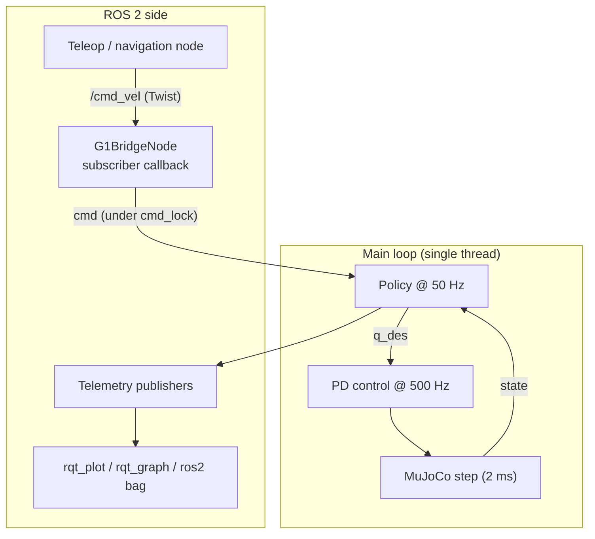

# Architecture

## The big picture

The robot has 12 controlled leg joints (6 per leg); the upper body is held fixed.

## Two loops, two rates (simulated time)

| Loop | Rate | Period | What happens |
|---|---|---|---|
| Physics + PD | 500 Hz | 2 ms (`simulation_dt = 0.002`) | torque = `Kp (q_des - q) - Kd dq`, then one MuJoCo step |
| Policy | 50 Hz | 20 ms (`control_decimation = 10`) | build the observation, run the network, update `q_des`, publish telemetry |

- The **policy** (slow "brain") decides where each joint should go, as offsets around the standing pose:
  `q_des = q_default + 0.25 * action`.
- The **PD controller** (fast "reflex") converts the remaining position error into torque.
  The network never outputs torques directly.
- Between two policy steps, `q_des` is held constant for 10 physics steps.

## Execution model of the ROS 2 node

1. At **every physics step**, the loop calls `rclpy.spin_once(node, timeout_sec=0.0)`.
   This processes pending messages and returns immediately if there are none (non-blocking).
2. The `/cmd_vel` callback writes `(vx, vy, wz)` into the shared array `cmd` under a mutex (`cmd_lock`).
3. At each **policy step**, the loop copies `cmd` under the same mutex and builds the observation.

Everything runs in **one thread**, so the lock is not strictly required; it is kept so that the code stays correct
if the node is moved to a multi-threaded executor. Consequence: a slow callback or a slow inference delays the next
physics step. Simulated time is not affected, but the simulation may run slower than real time.

## Four stages

| Stage | Where | Rate |
|---|---|---|
| 1. External command | any ROS 2 node publishing `/cmd_vel` | asynchronous |
| 2. Callback processing | `spin_once` in the main loop | every physics step |
| 3. Policy evaluation and telemetry | main loop, every 10th step | 50 Hz |
| 4. Physics and motor control | main loop | 500 Hz |

Diagrams: see the report in `report/`.

## What comes from where

| Item | Source |
|---|---|
| Walking policy `motion.pt`, robot model, `g1.yaml`, original loop | Unitree (`unitree_rl_gym`) |
| `G1BridgeNode`, `/cmd_vel` input, telemetry, analysis tool | this repository |
